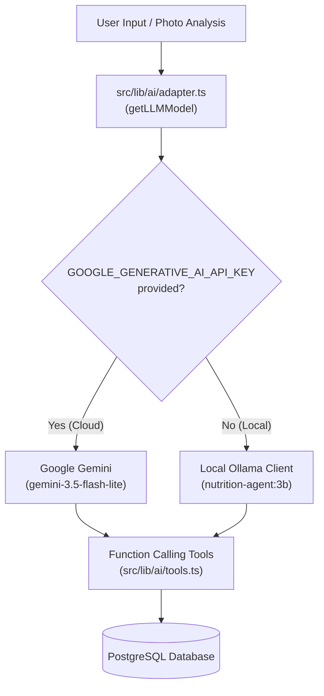

# 📁 dvkTrack — Project Structure & Architectural Guidelines

This document details the codebase organization, data layer, AI engine, and component topology for **dvkTrack** (`nutrition-tracker`).

---

## 1. Directory Topology

```
nutrition-tracker/
├── .agent/
│   └── rules/
│       ├── design-system.md           # Fresh Herb Green palette, radius hierarchy, tokens
│       ├── project-structure.md       # Architectural breakdown (this file)
│       └── deployment-and-server.md   # Mini PC host, ports (3001/5433), CI/CD, tunnel
├── .github/
│   └── workflows/
│       └── deploy.yml                 # Two-stage CI/CD: quality check -> Mini PC deploy
├── prisma/
│   ├── schema.prisma                  # PostgreSQL schema definitions & relations
│   └── migrations/                    # Versioned SQL migration scripts
├── public/                            # Static assets, PWA manifests, icons
├── scripts/                           # Standalone database utilities & seeders
├── utils/
│   ├── calculations/                  # Nutrition math, macros, energy balance
│   ├── prisma/
│   │   └── prisma.ts                  # Shared PrismaClient instance & retry handlers
│   └── schemas/                       # Zod validation schemas
├── src/
│   ├── i18n/                          # Routing & locale configuration (uk default, en)
│   ├── messages/                      # Translation dictionaries (uk.json, en.json)
│   ├── lib/
│   │   ├── ai/                        # Dual AI Engine (Gemini + Local Ollama)
│   │   │   ├── adapter.ts             # Hybrid model selector & provider adapter
│   │   │   ├── tools.ts               # Function-calling tools for nutrition logging
│   │   │   ├── system-prompt.ts       # Structured nutrition assistant system prompt
│   │   │   └── logger.ts              # Latency, token, and call diagnostics
│   │   ├── db/
│   │   │   └── index.ts               # Clean export bridge to Prisma client
│   │   ├── auth.ts                    # Session & authentication helpers
│   │   ├── http.ts                    # Axios / fetch HTTP client utilities
│   │   ├── queryClient.ts             # TanStack Query client configuration
│   │   └── utils.ts                   # Class name mergers (clsx + twMerge)
│   ├── components/                    # Component hierarchy
│   │   ├── ui/                        # Atomic primitives (button, card, dialog, dvk-logo)
│   │   ├── dashboard/                 # Food diary, daily goals, macro progress calendars
│   │   ├── recipes/                   # Recipe builder, ingredient tables, nutrition view
│   │   ├── ingredients/               # Custom and canonical food ingredient lists
│   │   ├── ai/                        # Floating AI Assistant panel, tool cards, chat
│   │   ├── forms/                     # Add/edit food, recipe update forms
│   │   ├── layout/                    # AppShell, Header, ThemeSwitcher, LanguageSwitcher
│   │   └── providers/                 # React Query, Theme, and i18n context providers
│   └── app/                           # Next.js 15 App Router
│       ├── api/                       # API Route Handlers
│       │   ├── auth/                  # Register / login authentication endpoints
│       │   ├── ai/                    # AI chat streaming and session persistence
│       │   ├── dashboard/             # Daily overview and aggregated macro stats
│       │   ├── food-log/              # Food entries CRUD and daily summaries
│       │   ├── ingredients/           # Ingredient database search and CRUD
│       │   ├── recipes/               # Recipe management and nutrition calculations
│       │   └── goals/                 # Daily calorie and macro target settings
│       ├── [locale]/                  # Localized page tree (uk / en)
│       │   ├── (pages)/               # Grouped routes (dashboard, recipes, ingredients)
│       │   └── layout.tsx             # Root localized HTML shell
│       ├── hooks/                     # Custom React hooks (useFoodLog, useRecipes, etc.)
│       ├── services/                  # API communication layer for client components
│       ├── globals.css                # CSS variables, Tailwind tokens & color rules
│       └── layout.tsx                 # Base HTML shell
├── Dockerfile                         # Standalone multi-stage build (Node 22)
├── docker-compose.yml                 # Service definitions (app: 3001, postgres: 5433, ollama)
├── package.json                       # Scripts and project dependencies
└── yarn.lock                          # Yarn dependency lockfile
```

---

## 2. Next.js 15 App Router Architecture

dvkTrack leverages Next.js 15 with Turbopack and the App Router:

### 2.1. Localization Routing (`src/app/[locale]/`)
- Uses `next-intl` with standard prefixing.
- Supported locales: `uk` (Ukrainian - **default**) and `en` (English).
- Path resolution handled by `src/middleware.ts` and `src/i18n/routing.ts`.
- Translation dictionaries live in `src/messages/uk.json` and `src/messages/en.json`. All user-facing strings must have corresponding keys in both files.

### 2.2. API Route Handlers (`src/app/api/`)
- Pure JSON REST endpoints providing full CRUD operations.
- All handlers interact with the database through `prisma` and return standardized responses with error handling.
- Key API endpoints:
  - `POST /api/ai/chat`: Streams LLM responses with function calling for logging food and recipes.
  - `GET/POST /api/food-log`: Fetches and records daily meal diary entries.
  - `GET/POST /api/recipes`: Manages complex multi-ingredient recipes with automatic nutrition sum calculations.
  - `GET/POST /api/ingredients`: Searches global and custom ingredients.
  - `GET/PUT /api/goals`: Updates user-defined daily calorie and macro goals.

---

## 3. Prisma ORM & Database Layer

PostgreSQL 16 runs in Docker container `nutrition_tracker_db` bound to host port `5433`.

### 3.1. Database Connection & Client
- Managed in `utils/prisma/prisma.ts` with connection pooling and automated retry handling for transient disconnects.
- Exported cleanly for application modules via `src/lib/db/index.ts`.

### 3.2. Core Schema Models (`prisma/schema.prisma`)

1. **`User`**:
   - Stores account credentials, password hash, and relation to all personal data.
   - Relations: `dailyGoal`, `recipes`, `foodLogEntries`, `ingredients`, `chatSessions`.

2. **`Ingredient`**:
   - Defines raw or packaged food items with macro-nutritional values per 100g: `caloriesPer100g`, `proteinPer100g`, `carbsPer100g`, `fatPer100g`, `fiberPer100g`.
   - Supports global common ingredients (`userId: null`, `isCustom: false`) and user-created custom entries.

3. **`Recipe` & `RecipeIngredient`**:
   - Represents compound meals with preparation descriptions, cooking times, target servings, and cooked weight.
   - Joined to multiple ingredients via `RecipeIngredient` with specific `quantityGrams`.

4. **`FoodLogEntry`**:
   - Logs what a user consumed on a specific calendar `date` and `mealType` (`BREAKFAST`, `SNACK_1`, `LUNCH`, `SNACK_2`, `DINNER`).
   - Links to either an `Ingredient` or a `Recipe` (or custom ad-hoc entry).
   - Records calculated snapshot values for calories, protein, carbs, fat, and fiber.

5. **`DailyGoal`**:
   - Defines daily target calories, maintenance calorie baseline, and macro distributions (`protein`, `carbs`, `fat`, `fiber`).
   - Goal types: `WEIGHT_LOSS`, `MUSCLE_GAIN`, `MAINTENANCE`.

6. **`ChatSession` & `ChatMessage`**:
   - Persists conversational interactions with the AI nutrition assistant, including tool call records and LLM responses.

---

## 4. AI Engine Architecture (`src/lib/ai/`)

dvkTrack features a flexible **hybrid LLM architecture** providing high-accuracy cloud analysis with offline-first local fallback.



### 4.1. Model Adapter (`src/lib/ai/adapter.ts`)
- **Primary Provider**: Google Gemini via `@ai-sdk/google`. Defaults to `gemini-3.5-flash-lite`.
- **Fallback / Local Provider**: Ollama via `@ai-sdk/openai-compatible`. Connects to `http://ollama:11434` (Docker) or `http://127.0.0.1:11434` (Host) using model `nutrition-agent:3b`.
- Automatic detection via `getActiveModelInfo()` surfaces the active provider to the UI.

### 4.2. Tool Execution (`src/lib/ai/tools.ts`)
The AI agent is equipped with type-safe tools using Zod schemas:
- `searchIngredients`: Look up nutritional data for foods.
- `logFoodItem`: Automatically insert entries into the user's food diary.
- `createCustomRecipe`: Build multi-ingredient recipes with aggregated macros directly from conversational instructions.
- `getDailyProgress`: Check remaining calories and macro ratios for the day.

### 4.3. System Prompt & Guardrails (`src/lib/ai/system-prompt.ts`)
- Instructs the agent to act as a certified nutrition assistant.
- Strictly adheres to user locale (`uk` or `en`).
- Formats meal suggestions with precise gram weights, calorie counts, and macro breakdowns.

---

## 5. Components & UI Organization

The component tree in `src/components/` follows domain-driven separation:

- **`ui/`**: Base UI elements adhering to the unified design contract (40px/36px/32px button sizes, 14px/12px/10px/16px radiuses, `DvkLogo`, `DvkIcon`).
- **`dashboard/`**: The core screen components:
  - `DailyFoodDiary.tsx`: Meal sections grouped by breakfast, lunch, dinner, snacks.
  - `DashboardStatsBanner.tsx`: Top overview of remaining calories and macro rings.
  - `NutritionGoalChart.tsx`: Visual progress against maintenance and deficit thresholds.
- **`recipes/`**: Recipe catalog, detail modal, cooking instructions, and macro percentages.
- **`ingredients/`**: Searchable ingredient directory with quick filter tags.
- **`ai/`**: Floating assistant trigger (`AIAssistantTrigger`), slide-out drawer (`AIChatSidebar`), and interactive tool execution previews (`AIToolCard`).
- **`layout/`**: `AppShell`, persistent `Header`, `LanguageSwitcher`, and `ThemeSwitcher`.
