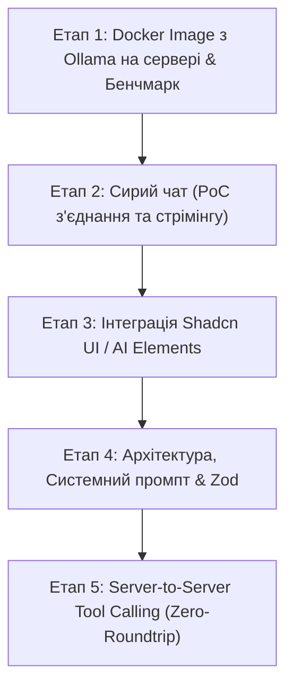

# Handoff: AI Food Logging & Chat Assistant

Цей документ містить покроковий план розробки та впровадження локального AI-асистента для швидкого трекінгу їжі людською мовою через чат із прямим серверним викликом інструментів (Tool Calling / MCP).

---

## 📌 Контекст та цілі проекту

* **Мета**: Дати користувачеві можливість ввести або надиктувати в чат: *«З'їв на обід 200г вареної гречки та 150г запеченого курячого філе»*, після чого система самостійно знайде продукти в базі, за потреби створить нові, розрахує КБЖВ та запише їх у щоденник харчування без зайвих кліків у формах.
* **Серверний хост**: Mini PC Dell OptiPlex 3050 (Intel Core i5-7500T 4C/4T @ 2.7–3.3 GHz, 16 GB DDR4, Ubuntu 26.04 LTS, IP: `192.168.0.103`).
* **Локальний стек**: Next.js 15 (App Router), Prisma ORM, PostgreSQL (порт `5433`), Docker Compose, Ollama (LLM Engine).

---

## 🗺️ Етапи реалізації



---

## 🚀 Етап 1: Docker Image з Ollama на сервері та бенчмаркінг

### Завдання
1. Розгорнути офіційний Docker-контейнер `ollama/ollama` на Mini PC поруч із додатком і базою даних.
2. Налаштувати зв'язок у `docker-compose.yml` з постійним збереженням завантажених моделей у Docker Volume.
3. Завантажити та протестувати кілька моделей-кандидатів:
   * `qwen2.5:1.5b` (ультра-легка)
   * `qwen2.5:3b` (рекомендований баланс інтелекту та швидкості)
   * `llama3.2:3b` (альтернатива від Meta)
4. Провести заміри швидкості (бенчмаркінг) на процесорі i5-7500T з використанням AVX2 інструкцій.

### Технічні деталі
* **Порт**: `11434` (прив'язати локально `127.0.0.1:11434:11434` або в спільну docker-мережу `nutrition-network`).
* **Volume**: `ollama_data:/root/.ollama` (щоб моделі не перекачувалися після перезапуску контейнера).
* **Метрики для заміру**:
  * **TTFT (Time to First Token)**: час до початку генерації (цільовий: < 1.0 с).
  * **Швидкість генерації**: токенів на секунду (цільова: > 12–15 tok/s для 3B).
  * **Споживання RAM**: під навантаженням (ліміт: до 3–3.5 GB для моделі 3B).
  * **Температура та навантаження CPU**: перевірка стабільності охолодження.

### Критерії готовності (DoD)
* [x] Контейнер `nutrition_tracker_ollama` стабільно працює у фоні з `restart: unless-stopped`.
* [x] Ендпоінт `http://127.0.0.1:11434/api/tags` повертає список завантажених моделей.
* [x] Зафіксовано результати замірів швидкості для 1.5B та 3B моделей.

#### Результати бенчмаркінгу на Intel Core i5-7500T (4C/4T @ 2.7–3.3 GHz, 16 GB RAM):
| Модель | Cold Load | Warm TTFT | Швидкість генерації | RAM в Docker | Повний час (Warm) |
|---|---|---|---|---|---|
| **`qwen2.5:1.5b`** | 2.32 с | **0.04 с** | **23.9 tok/s** | **1.24 GB** | 5.02 с |
| **`qwen2.5:3b`**   | 3.07 с | **0.08 с** | **13.1 tok/s** | **3.25 GB** | 5.10 с |
| **`llama3.2:3b`**  | 3.59 с | **0.08 с** | **12.4 tok/s** | **5.63 GB** | 5.95 с |

> **Висновки бенчмарку:**
> 1. `qwen2.5:1.5b` демонструє чудову швидкість (~24 tok/s) та мале споживання RAM (1.2 GB), ідеально розуміє контекст їжі українською.
> 2. `qwen2.5:3b` показує оптимальний баланс структури й швидкості (~13.1 tok/s) та повністю вкладається у бюджет пам'яті (3.25 GB).
> 3. `llama3.2:3b` споживає суттєво більше пам'яті (5.6 GB) при дещо нижчій швидкості (12.4 tok/s).

---

## 💬 Етап 2: Сирий чат (PoC / Raw Chat)

### Завдання
1. Створити мінімальний серверний маршрут у Next.js (`src/app/api/ai/chat/route.ts`), що проксує запити до локальної Ollama через стандартний OpenAI-сумісний API (`http://localhost:11434/v1/chat/completions`).
2. Налаштувати стрімінг відповідей (Server-Sent Events / ReadableStream) без буферизації.
3. Створити сиру сторінку/компонент для перевірки: поле введення, кнопка відправки, стрімінг відповіді по токенах.
4. Перевірити роботу в середовищі dev (порт `4000`) та у продакшені (порт `3001`).

### Технічні деталі
* Бібліотека для зв'язку: нативний `fetch` або Vercel AI SDK (`ai` + `@ai-sdk/openai` із `baseURL: "http://localhost:11434/v1"`).
* Обробка помилок: тайм-аут запиту, недоступність Ollama або відсутність завантаженої моделі.

### Критерії готовності (DoD)
* [ ] Запит із браузера надходить на бекенд Next.js і передається в Ollama.
* [ ] Відповідь друкується посимвольно/потоково в реальному часі без затримок.
* [ ] Відображається зрозумілий статус при відключеній Ollama.

---

## 🎨 Етап 3: Інтеграція Shadcn UI / AI Elements

### Завдання
1. Інтегрувати сучасний UI чату на базі компонентів `shadcn/ui` та патернів AI Elements.
2. Розробити ергономічний інтерфейс:
   * Поле введення повідомлення з автоматичною висотою (Auto-expanding textarea).
   * Кнопка швидкої відправки / клавіша `Enter` (і `Shift+Enter` для нового рядка).
   * Індикатор генерації та можливість зупинити стрімінг (Stop generation).
   * Швидкі картки-підказки (Quick Prompt Pills), наприклад:
     * *«Сніданок: 2 смажені яйця та тост із сиром»*
     * *«Обід: 200г курячого філе та 150г гречки»*
     * *«Перекус: яблуко 180г та американо»*
3. Повна адаптивність під мобільні екрани (розташування у нижній частині екрана зі зручною фіксацією над клавіатурою).
4. Підтримка поточної теми (світла/темна) та локалізації (UA/EN).

### Критерії готовності (DoD)
* [ ] Чат виглядає нативно, гармонійно вписуючись у загальний дизайн щоденника.
* [ ] Повідомлення користувача та асистента чітко розділені, підтримують Markdown-форматування.
* [ ] Швидкі підказки заповнюють інпут в один клік.

---

## 🏗️ Етап 4: Архітектура, Системний промпт & Валідація Zod

### Завдання
1. Побудувати чисту серверну архітектуру з чітким розділенням шарів:
   * **UI Layer**: клієнтський компонент чату зі станом.
   * **Route Handler / Action**: контролер, який приймає запит і викликає AI-сервіс.
   * **AI Agent Service**: інкапсулює логіку підготовки промпту, виклику моделі та обробки інструментів.
   * **Tool Registry**: набір типізованих функцій з Zod-схемами.
   * **Data Access Layer**: прямі виклики Prisma до БД.
2. Розробити спеціалізований **Системний промпт**:
   * **Жорстка лаконічність**: заборона довгих міркувань чи порад щодо дієти.
   * **Фокус на дію**: пріоритет виклику функцій (Tool Calling).
   * **Визначення контексту**: поточна дата, поточний час, автовизначення прийому їжі (`BREAKFAST`, `SNACK_1`, `LUNCH`, `SNACK_2`, `DINNER`).
   * **Правила конвертації**: як інтерпретувати штуки у грами (наприклад, 1 середнє яйце = 55г).
3. Валідація аргументів: кожен виклик функції проходить строгу Zod-валідацію перед зверненням до БД.

### Критерії готовності (DoD)
* [ ] Модель не видає «води» та зайвих філософських відповідей.
* [ ] Аргументи функцій завжди валідні за типами даних (числа не приходять у вигляді рядків).
* [ ] Вся бізнес-логіка покрита типами TypeScript без `any`.

---

## ⚡ Етап 5: Server-to-Server Tool Calling (Zero-Roundtrip)

### Концепція архітектури без зайвих раундтріпів
Традиційний підхід передає запит на виклик інструменту назад у браузер, браузер виконує запит до свого API і знову шле результат у модель. Це створює 2–3 зайві мережеві затримки.

У нашому рішенні **весь цикл відбувається виключно всередині сервера (Server-to-Server)**:

```
[Браузер] ── (1) Текст користувача ───────────────────────────► [Next.js Бекенд]
                                                                        │
                                                                 (2) Запит до LLM
                                                                        ▼
                                                                 [Ollama Local]
                                                                        │
                                                                 (3) Tool Call (JSON)
                                                                        ▼
[PostgreSQL] ◄── (4) Прямий Prisma-запит ──────────────────────── [Next.js Бекенд]
     │
(5) Дані запису збережено!
     │
     └────────── (6) Результат повертається в Ollama ───────────► [Ollama Local]
                                                                        │
                                                                 (7) Коротке "ОК"
                                                                        ▼
[Браузер] ◄── (8) Фінальна стрім-відповідь + оновлення кешу ────── [Next.js Бекенд]
```

### Специфікація інструментів (Tools)

1. **`search_food(query: string)`**:
   * Шукає збіги за назвою серед рецептів (`recipes`) та продуктів (`ingredients`).
   * Повертає список знайдених позицій з їх КБЖВ на 100г.

2. **`create_ingredient(name, calories, protein, fat, carbs, fiber)`**:
   * Викликається автоматично, якщо користувач з'їв щось нове, чого немає в базі.
   * Модель бере стандартну поживну цінність і створює продукт у таблиці `ingredients`.

3. **`log_food_entry(meal_type, date, items: Array<{ name, weight_grams, calories, protein, fat, carbs, fiber, recipe_id?, ingredient_id? }>)`**:
   * Записує одне або кілька споживань у таблицю `food_log_entries`.
   * Пов'язує з відповідною стравою або інгредієнтом, якщо вони знайдені.

4. **Клієнтська синхронізація**:
   * Після завершення стріму відповіді клієнт автоматично робить:
     ```ts
     queryClient.invalidateQueries({ queryKey: ["foodLog"] });
     queryClient.invalidateQueries({ queryKey: ["foodLogSummary"] });
     ```
   * Дані щоденника, калорійні кола в календарі та банери дефіциту миттєво оновлюються в UI без перезавантаження сторінки.

### Критерії готовності (DoD)
* [ ] Фраза в чаті призводить до реального створення записів у базі даних PostgreSQL.
* [ ] Невідомі продукти автоматично поповнюють базу інгредієнтів.
* [ ] Щоденник і графіки оновлюються на очах користувача відразу після підтвердження від асистента.
* [ ] Повна операція займає 1.5–2.5 секунди на Mini PC.

---

## 📋 Чеклист для початку роботи

* [ ] Додати сервіс `ollama` до `docker-compose.yml`.
* [ ] Оновити `docker compose up -d` на сервері та перевірити роботу `curl http://127.0.0.1:11434`.
* [ ] Виконати тестовий пулл моделі `ollama pull qwen2.5:3b`.
* [ ] Запустити тест продуктивності генерації через CLI.
